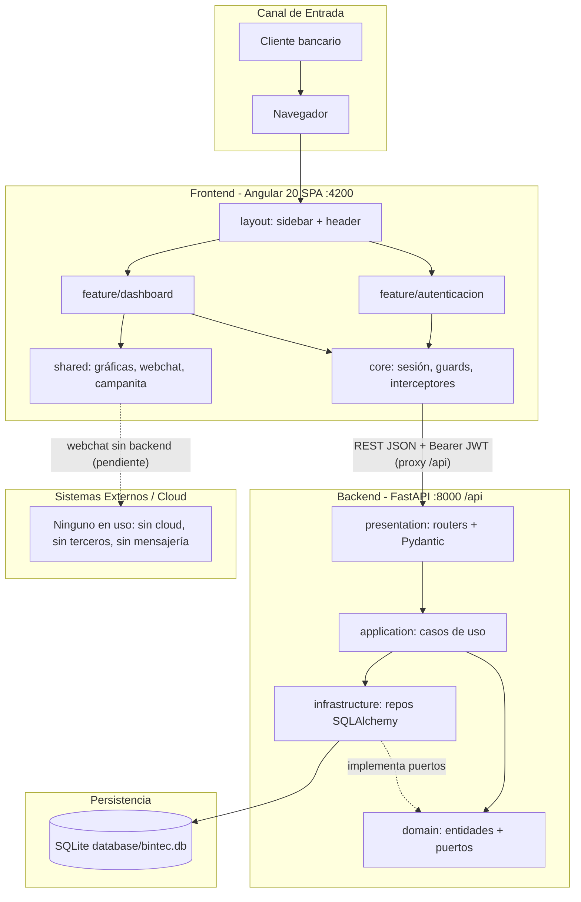

# Arquitectura del Sistema - GPS Principal

Este documento sirve como **GPS arquitectónico** para orientar decisiones de diseño y desarrollo en el ecosistema.

## Resumen Ejecutivo

### Propósito y alcance del sistema

- **Bintec Banca en línea**: demo (taller Bintec 2026) de banca en línea para un cliente: login, dashboard financiero, productos (cuentas de ahorro, tarjetas, créditos), reportes de movimientos con descarga CSV, analítica de consumo y oferta de crédito preaprobado.
- **Dos repositorios acoplados por contrato JSON**: SPA Angular 20 (`docs/frontend`) y API FastAPI (`docs/backend`). El JSON usa camelCase y espeja las interfaces TypeScript de `feature/dashboard`.
- **Estado**: demo funcional de un solo cliente; el **webchat de aprobación de crédito es solo cascarón visual** (sin backend de conversaciones).
- **Fuera de alcance**: sistemas bancarios core, pasarelas de pago, mensajería/eventos, infraestructura cloud (no existe despliegue definido).

### Dominios y repositorios críticos

- **Repositorios críticos**: `backend` (reglas de negocio, seguridad, datos), `frontend` (UX, sesión, consumo de API).
- **Dominios/módulos críticos (backend)**: `identidad` (JWT/login, base de la seguridad), `dashboard` (compone tarjetas, créditos y movimientos), `notificaciones` (oferta preaprobada; crea crédito al aceptar), `movimientos`/`analitica` (reportes y gráficas).
- **Dominios secundarios**: `cuentas`, `tarjetas`, `creditos` (entidades con invariantes de dominio).
- **Features (frontend)**: `autenticacion` y `dashboard` (único feature enrutado, lazy-loaded). `inicio` y `producto` son restos de plantilla sin enrutar.
- **Límites**: incluye SPA + API + SQLite local; no incluye CI/CD del backend, entornos productivos ni integraciones externas.

## Arquitectura de Alto Nivel

### Diagrama principal del ecosistema

- **Frontend**: capas `core`, `shared`, `layout`, `feature` con reglas de dependencia validadas por ESLint *boundaries*; features nunca se importan entre sí; lazy loading por feature; componentes standalone con `OnPush` y signals.
- **Backend**: hexagonal + DDD modular. Un módulo por dominio con `domain` / `application` / `infrastructure` / `presentation`; composición en `app/main.py` (`crear_app`) y cableado por módulo en `presentation/dependencies.py`.
- **Dependencias entre módulos backend**: `dashboard` depende de `creditos`, `tarjetas`, `movimientos`; `analitica` de `movimientos`; `notificaciones` de `creditos`; todos de `identidad` (solo en `presentation`).
- **Comunicación**: único canal REST síncrono bajo `/api`; en desarrollo el proxy de Angular (`proxy.conf.json`) redirige `/api` a `localhost:8000`.
- **Ciclo de vida**: al iniciar crea el esquema (`create_all`) y siembra el cliente demo con 3 años de historial si la base está vacía.

## Stack y Patrones Clave

### Tecnologías que condicionan arquitectura

- **Lenguajes/frameworks clave**: Angular 20 + TypeScript + RxJS (Node 20 recomendado); Python + FastAPI 0.143 + SQLAlchemy 2.1 + Pydantic 2.14 + PyJWT.
- **Datos y persistencia**: SQLite en archivo local (`database/bintec.db`, esquema en `database/schema.sql`); sin migraciones Alembic (`create_all` + `python -m app.seed --reset`). Limita concurrencia y escalado horizontal.
- **Plataforma/infraestructura**: sin Docker ni despliegue definido en el backend; frontend con `Jenkinsfile` (agente `Slave_Induccion`, NodeJS20: install, build, lint, test unitario, test de componente, SonarQube).
- **Calidad**: frontend Karma/Jasmine + Cypress (E2E heredado, no mantenido) + ESLint estricto + Prettier; backend pytest (70 tests, cobertura > 80 % exigida), ruff y mypy strict.
- **Configuración**: backend por variables `BINTEC_*` (`.env.example`); frontend `environment.ts` con `endpoint: '/api'`.

### Patrones arquitectónicos relevantes

- **Arquitectura hexagonal (Ports & Adapters) + DDD modular** — backend. **Impacto**: dominio sin FastAPI/SQLAlchemy, testeable aislado, cambio de SQLite a otro motor sin tocar reglas.
- **Capas con boundaries (Clean Architecture ligera)** — frontend. **Impacto**: ESLint rompe el build ante imports prohibidos; evita acoplamiento entre features.
- **Estado reactivo con Signals** (`SesionService`, sin NgRx). **Impacto**: simple y suficiente hoy; revisar si crece el estado compartido.
- **Modelo de lectura** (`analitica`) separado del dominio transaccional. **Impacto**: agregaciones de consumo no contaminan entidades.
- **Contrato compartido implícito** (camelCase + interfaces TS). **Impacto**: sin OpenAPI generado ni validación de contrato; riesgo de desincronización manual.
- **Pruebas con ComponentObject** (`*.co.ts`) en frontend. **Impacto**: tests mantenibles.

## Integraciones Críticas

### Integraciones internas y externas de mayor impacto

| Integración | Canal/protocolo | Criticidad |
|---|---|---|
| Frontend → Backend (todas las pantallas) | REST/JSON bajo `/api`, proxy en dev | Alto |
| Backend → SQLite | SQLAlchemy 2 (conexión directa a archivo) | Alto |
| `dashboard` → `creditos`/`tarjetas`/`movimientos` | Llamadas internas entre módulos (application/domain) | Medio |
| `notificaciones` → `creditos` | Aceptar oferta crea crédito de libre inversión (una sola vez, 409 si ya resuelta) | Medio |
| Frontend webchat → backend de conversaciones | **No existe aún** (módulo `conversaciones` planificado; REST primero, WebSocket después) | Medio (evolución) |
| Frontend → descarga CSV de reportes | Generación en cliente sobre `/movimientos/reporte` | Bajo |

- **Flujos críticos**: (1) login en dos pasos (correo/clave → desafío → clave de cajero + código de seguridad → JWT) → dashboard; (2) oferta preaprobada: campanita → detalle → "Aceptar" abre webchat (el endpoint `aceptar` no se usa desde la UI); (3) reportes filtrables por fecha/tipo.

### Seguridad de integración (Auth/Authz)

- **Autenticación**: segundo factor en dos pasos: `POST /api/auth/login` (correo + clave) → desafío JWT de 5 min (`typ=desafio`, no sirve como sesión); `POST /api/auth/verificar` (clave de cajero de 4 dígitos + código de seguridad de 6) → JWT de acceso HS256 (60 min por defecto, `typ=acceso`). Claves con scrypt + sal; mismo error para correo inexistente y clave incorrecta. El código de seguridad es fijo en la demo (puerto `VerificadorCodigoSeguridad`, intercambiable por TOTP/SMS). Token guardado en `sessionStorage` y enviado como `Authorization: Bearer` por `autenticacionInterceptor`.
- **Autorización**: todas las rutas salvo `login` y `salud` exigen Bearer; en frontend `seguridadGuard` (dashboard) e `invitadoGuard` (login). Anti-BOLA/IDOR: toda consulta se acota al `usuario_id` del token, sin IDs de usuario en rutas.
- **Controles críticos**: bloqueo temporal de cuenta tras 3 intentos fallidos (15 min, HTTP 423; aplica a ambos pasos del login); CORS restringido a `BINTEC_CORS_ORIGENES` (solo GET/POST); manejo uniforme de errores `{detail, code}`; secreto JWT por entorno (cambiar el de demo).
- **Brechas para producción**: el bloqueo es por cuenta (no por IP) y el mensaje `cuenta_bloqueada` revela que el correo existe, código de seguridad fijo (no OTP real), sin revocación/rotación de tokens, sin HTTPS, sin auditoría; token en `sessionStorage` expuesto a XSS.

## Dependencias Externas Estratégicas

### Servicios y terceros que condicionan la solución

- **Servicios externos críticos**: ninguno en tiempo de ejecución (sin cloud ni APIs de terceros).
- **Dependencia operativa**: el frontend no funciona sin el backend activo (login muestra error genérico y el proxy registra `ECONNREFUSED`).
- **Infraestructura de CI**: Jenkins corporativo (`ceiba-jenkins-library`) y SonarQube (`co.com.ceiba.poc:app-base`) solo para el frontend.
- **Herramientas con requisito de sistema**: Graphviz (análisis de dependencias con madge), Chrome headless (Karma).

### Discrepancias y riesgos detectados (documentación vs. código)

- **`apiKeyInterceptor` heredado de plantilla**: envía `x-api-key: reqres-free-v1` en todas las peticiones, incluidas las del backend propio; no está documentado ni lo usa la API. Además, `allow_headers` del CORS no incluye `x-api-key`, por lo que fallaría el preflight si front y back se despliegan en orígenes distintos. **Acción**: eliminarlo.
- **Restos de plantilla** `feature/producto` e `feature/inicio` (sin ruta) y Cypress sin mantener; `ARQUITECTURA.md` aún cita features `cliente`/`inicio` y `AppModule` (la app es standalone).
- **Regla de boundaries**: `feature` solo permite `shared`, `core`, `env`; verificar que `dashboard`/`autenticacion` la cumplan (lo valida `npm run lint`).
- **Sin pipeline ni contenedores para el backend** y sin migraciones de base de datos.

## Referencias Base

### Documentación analizada y fuentes clave

- `frontend/readme.md`, `frontend/guidelines/ARQUITECTURA.md`, `BOUNDARIES.md`, `DEPENDENCIAS.md`.
- `backend/README.md` (API, arquitectura, seguridad, base de datos).
- Código validado: `frontend/src/app/app.routes.ts`, `app.config.ts`, `core/core.ts`, `core/interceptors/*`, `core/services/sesion`, `environments/environment.ts`, `proxy.conf.json`, `package.json`, `Jenkinsfile`; `backend/app/main.py`, estructura `app/modules/*`, `requirements.txt`, `.env.example`, `database/`.
- No aportan señal arquitectónica (omitidos): `ESLINT-RULES.md`, `IMPORT-ORDER.md`, `PRETTIER.md`.

---

**Este GPS es una vista arquitectónica ejecutiva para orientar decisiones y priorizar evolución del sistema.**

---

> **Método Ceiba documentar-arquitectura-base** v6.1.97 | Modelo: Claude Sonnet 5.5 | Usuario: Wilmer Giovanny Torres Achury | Fecha: 2026-10-12
