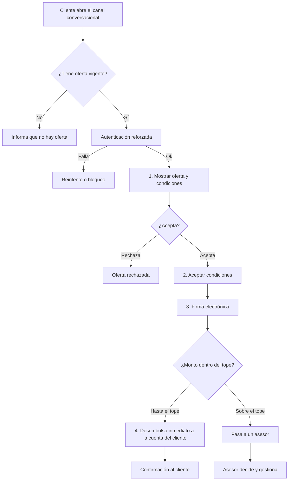
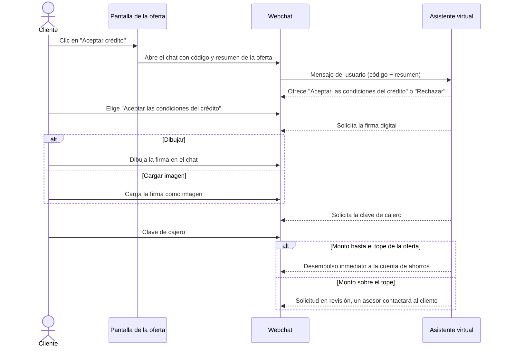

# Contexto de la necesidad: crédito preaprobado por canal conversacional

> **Documento de contexto (no es historia de usuario).** Complementa la necesidad planteada en el reto del taller Bintec 2026 con lo que ya existe en el proyecto, lo que falta y lo que hay que decidir antes de escribir historias.
> **Caso ficticio** creado para el ejercicio; no corresponde a ningún cliente de Ceiba.
> Los puntos marcados como **[Supuesto]** o **[Por definir]** no vienen del reto ni del código: hay que validarlos con la sala.

---

## 1. La necesidad

Un cliente con **crédito preaprobado** debe poder **aceptarlo y recibir el desembolso sin ir a una oficina**, usando el canal conversacional (webchat) de la banca en línea.

### Reglas del negocio (dadas en el reto)

| # | Regla |
|---|-------|
| R1 | Solo clientes con **oferta vigente**. |
| R2 | **Autenticación reforzada** antes de mostrar la oferta. |
| R3 | La aceptación se hace con **firma electrónica**. |
| R4 | Si el monto está **hasta el tope**, el desembolso es **inmediato**. |
| R5 | Si el monto está **sobre el tope**, el caso **pasa a un asesor**. |

### Qué falta construir (dado en el reto)

El canal ya atiende consultas. Hay que agregar cuatro capacidades, que son además las **4 etapas del ciclo**:

1. **Mostrar** la oferta al cliente. *(Ya existe en el proyecto como pantalla `/dashboard/oferta-credito/:id`; ver sección 2.)*
2. **Aceptar** las condiciones.
3. **Firmar.**
4. **Desembolsar** a la cuenta del cliente.

---

## 2. Punto de partida: qué existe hoy en el proyecto

Fuente: [architecture/index.md](architecture/index.md) y [backend/README.md](backend/README.md).

**Producto:** Bintec Banca en línea, una demo de un solo cliente con SPA Angular 20 y API FastAPI (hexagonal + DDD modular) sobre SQLite. No hay sistemas bancarios core, pasarelas de pago, mensajería ni cloud.

| Etapa del ciclo | Estado actual | Detalle |
|---|---|---|
| Autenticación | **Existe y no se modifica** | Login en dos pasos: correo y clave → desafío JWT de 5 min → clave de cajero (4 dígitos) + código de seguridad (6 dígitos, **fijo en la demo**) → JWT de acceso de 60 min. Bloqueo de cuenta tras 3 intentos (15 min). Existe el puerto `VerificadorCodigoSeguridad`, pensado para cambiarlo por TOTP/SMS. |
| Notificación de la oferta | **Ya existe** | La campanita del header (`campana-notificaciones`) muestra la notificación de la oferta preaprobada y lleva a la pantalla de detalle. No hay que construirla. |
| 1. Mostrar oferta | **Ya existe** | Pantalla de detalle en `/dashboard/oferta-credito/:id` (`OfertaCreditoComponent`), a la que se llega desde la campanita. Muestra los términos (monto, cuotas, tasa, cuota, total y primera cuota) desde `GET /notificaciones/{id}` y maneja los estados cargando, error, no encontrada, pendiente y resuelta (aceptada/rechazada). Lo único pendiente de esta etapa es la **clave de cajero** previa (R2, ver D1). |
| 2. Aceptar | Parcial | `POST /notificaciones/{id}/aceptar` existe y crea un crédito de libre inversión (una sola vez, 409 si ya se resolvió). **La UI no lo usa:** "Aceptar crédito" abre el webchat. También existe `/rechazar`. |
| Canal conversacional | Solo cascarón | El webchat es visual y no tiene backend de conversaciones. El módulo `conversaciones` está planificado (REST primero, WebSocket después). |
| 3. Firmar | No existe | No hay firma electrónica, evidencia de aceptación ni constancia. Se espera que el cliente dibuje la firma en el chat o cargue una imagen (ver sección 4). El chat no tiene lienzo ni carga de archivos. |
| 4. Desembolsar | No existe | Aceptar solo crea el registro del crédito. No hay movimiento de dinero ni abono a la cuenta de ahorros. |
| Tope y asesor | No existe | No hay tope de desembolso, estado "en revisión" ni traspaso a un asesor. |

**Decisión técnica ya documentada:** al integrar el chat, "aceptar" pasará a significar *iniciar la solicitud*, y el crédito se creará solo al terminar la aprobación. Esto implica un estado intermedio "en proceso" de la oferta.

---

## 3. Actores

| Actor | Rol en la necesidad |
|---|---|
| **Cliente** | Persona con oferta vigente que acepta, firma y recibe el dinero. |
| **Asesor** | Atiende los casos sobre el tope. **[Por definir]** cómo trabaja (bandeja, chat humano, aprobación manual). |
| **Canal conversacional** | Punto de interacción con el cliente; orquesta el recorrido. |
| **Sistema de cuentas/créditos** | Mantiene la oferta, el crédito y el saldo de la cuenta de destino. |
| **Proveedor de firma / segundo factor** | **[Supuesto]** simulado en la demo, como el código de seguridad fijo. |

---

## 4. Recorrido de alto nivel

> Es un flujo de referencia para conversar con la sala. No define pantallas ni mensajes del chat.

### Precisión de la etapa 2: qué pasa al hacer clic en "Aceptar crédito"

Al hacer clic en "Aceptar crédito" en `/dashboard/oferta-credito/:id`, el chat debe arrancar con el contexto de la oferta ya cargado:

1. Se abre el webchat.
2. El **resumen de la oferta** pasa al chat como un **mensaje del usuario** (el cliente), con dos datos adjuntos:
   - el **código de la oferta**;
   - el **resumen** de las condiciones (monto, cuotas, tasa, cuota, total y primera cuota).
3. Con ese mensaje el **asistente virtual** inicia la conversación y responde.
4. La respuesta del asistente ofrece las opciones **"Aceptar las condiciones del crédito"** y **"Rechazar"** (etapa 2).
5. Cuando el cliente acepta, el asistente le **solicita la firma digital** (etapa 3), que el cliente puede entregar de dos formas:
   - **dibujarla** directamente en el chat (lienzo de firma);
   - **cargarla como imagen**.
6. Se pide la **clave de cajero** para confirmar la firma.
7. Según el monto frente al tope de la oferta: **desembolso inmediato** a la cuenta de ahorros, o **solicitud en revisión** por un asesor (etapa 4).

**Estado actual frente a esto:** el webchat (`WebchatComponent`) es un cascarón visual. No recibe datos de entrada, no tiene mensajes ni envía nada. Hoy el clic solo lo muestra, sin pasarle información de la oferta. Esto obliga a que el chat acepte un mensaje inicial y a que exista el motor de conversación que responde (módulo `conversaciones`, pendiente).

**Definiciones acordadas** (detalle en la sección 6.1):
- El mensaje del usuario se **envía automáticamente** al abrir el chat.
- El "código de la oferta" es el **id de la notificación**.
- El asistente ofrece **Aceptar** y **Rechazar** las condiciones.
- La firma se **valida** (no vacía, se puede borrar y repetir), no se guarda como imagen y se confirma con la **clave de cajero**.
- Si el cliente cierra y reabre el chat, la conversación **se reinicia**.

**Pendientes:** ver sección 7.

---

## 5. Alcance sugerido para el ejercicio

**Dentro:**
- Recorrido completo del cliente de punta a punta en el webchat, con las 4 etapas.
- Etapa 2 (aceptar): el clic en "Aceptar crédito" abre el chat con el resumen y el código de la oferta como mensaje del usuario, y el asistente inicia la conversación.
- Etapa 1 (mostrar): **reutilizar la pantalla existente** `/dashboard/oferta-credito/:id`; solo se agrega la validación de oferta vigente (pendiente de decisión) y la clave de cajero previa.
- Bifurcación por tope: desembolso inmediato o traspaso a asesor.
- Estados de la oferta y trazabilidad de la aceptación y la firma.

**Fuera (a menos que la sala decida lo contrario):**
- Integración con un core bancario o una pasarela de pagos real **[Supuesto]**: el desembolso se simula abonando a la cuenta de ahorros demo.
- **Cualquier cambio al login actual** (flujo de dos pasos, desafío JWT, código de seguridad, bloqueo por intentos, puerto `VerificadorCodigoSeguridad`). Es una restricción: el login queda tal cual.
- Proveedor real de firma electrónica o de OTP **[Supuesto]**.
- Almacenamiento de la imagen de la firma.
- Chat con asesor y herramienta de back-office para el asesor.
- Persistencia y reanudación de la conversación.
- Análisis de riesgo o motor de preaprobación: la oferta ya llega preaprobada.

---

## 6. Decisiones que debe tomar la sala

El reto anuncia **4 decisiones de la sala** sin enumerarlas. Estas son las candidatas que surgen del análisis; hay que confirmarlas o reemplazarlas.

| # | Decisión | Por qué importa | Opciones |
|---|---|---|---|
| D1 | **Autenticación reforzada:** ¿qué factor adicional se pide antes de mostrar la oferta? | Hoy el login ya tiene dos pasos con código fijo. Hay que decidir si basta con la sesión actual o se pide un paso adicional al entrar a la oferta. | Reusar el segundo factor del login · pedir OTP nuevo en el chat · exigir sesión reciente |
| D2 | **Firma electrónica:** ¿qué constituye la firma y qué evidencia se guarda? | Define validez y auditoría. No existe nada hoy. | Ya definido: firma dibujada o cargada como imagen. Falta decidir si se complementa con OTP o clave de cajero y qué evidencia se guarda (hash de condiciones, fecha, dispositivo) |
| D3 | **Tope de desembolso:** ¿cuál es el valor, quién lo define y es por cliente o global? | Separa el camino automático del manual. | Valor fijo global · por perfil · parametrizable |
| D4 | **Traspaso al asesor:** ¿cómo y cuándo pasa el caso, y qué ve el cliente mientras espera? | Define el estado "en revisión" y la experiencia del cliente. | Cola de solicitudes · chat con humano · aprobación asíncrona con notificación |

Otras decisiones que probablemente salgan: qué pasa si la firma o el desembolso fallan a mitad de camino.

### 6.1 Decisiones tomadas

| # | Tema | Decisión |
|---|---|---|
| D1 | Autenticación reforzada | Se pide la **clave de cajero** (4 dígitos) al abrir la oferta, aunque ya haya sesión. Es una verificación **propia de este recorrido**; el login actual no se toca. |
| D2 | Firma electrónica | Firma dibujada en el chat o cargada como imagen, **más la clave de cajero** al confirmar. La imagen **no se guarda** en la demo. Se valida que no esté vacía y el cliente puede borrarla y repetirla. |
| D3 | Tope | Se define **por oferta**: cada oferta trae su propio tope. Requiere un campo nuevo en la oferta. |
| D4 | Asesor | Sobre el tope, la oferta pasa a **solicitud en revisión**; el asistente informa que un asesor contactará al cliente. No hay chat humano ni herramienta para el asesor. |
| — | Mensaje inicial | Se envía **automáticamente** al abrir el chat. |
| — | Código de la oferta | Es el **id de la notificación**. |
| — | Opciones del asistente | **Aceptar** y **Rechazar** las condiciones (Rechazar usa `/rechazar`). |
| — | Reapertura del chat | La conversación **se reinicia**; no se persiste. |
| — | Desembolso | **Abono a la cuenta de ahorros** del cliente, con un movimiento visible en el dashboard. |
| — | Vigencia | Vigente = **pendiente de decisión**; no hay fecha de vencimiento. |
| — | Monto y plazo | El cliente **acepta la oferta tal cual**; no elige monto ni plazo. |
| — | Cantidad de ofertas | **Una sola** oferta pendiente por cliente. |
| — | Clave de cajero | Se pide **dos veces**: al abrir la oferta y al confirmar la firma. |
| — | Intentos fallidos | **Ilimitados** en el chat; no hay bloqueo (ver riesgos). |
| — | Falla del abono | El asistente **informa y permite reintentar**; la oferta sigue pendiente y no se crea el crédito. |
| — | Creación del crédito | **Al desembolsar**, junto con el abono. En revisión, cuando el asesor apruebe. |
| — | Tiempo de respuesta del asesor | El asistente muestra un **mensaje fijo** con el plazo (por ejemplo, 1 día hábil). |
| — | Canal | **Pantalla + chat conviven**: la pantalla muestra la oferta y el chat se abre desde "Aceptar crédito". |
| — | Transporte | **REST** en la primera versión. |

---

## 7. Preguntas abiertas

**Todas las preguntas abiertas quedaron resueltas** (ver sección 6.1).

Queda como pendiente menor, que no bloquea las historias:
- Valor y redacción exacta del mensaje de plazo del asesor (por ejemplo, "1 día hábil").
- Cuánto tiempo vale la clave de cajero pedida al abrir la oferta, si el cliente deja el chat abierto mucho tiempo.

---

## 8. Riesgos y restricciones conocidas

| Riesgo / restricción | Origen | Impacto |
|---|---|---|
| Intentos ilimitados de la clave de cajero en el chat. | Chat | Aceptado para la demo. |
| Pedir la clave de cajero sin tocar el login exige una verificación aparte para esta clave, sin modificar los casos de uso, endpoints ni reglas de bloqueo de `identidad`. | Backend | Hay que diseñarla como pieza nueva; reutiliza solo el hash de la clave ya guardado. **[Supuesto]** a validar con el código de `identidad`. |
| El código de seguridad es fijo en la demo; no es una autenticación reforzada real. | Backend | Una "autenticación reforzada" sobre ese mecanismo es solo simulada. |
| Aceptar hoy crea el crédito inmediatamente, sin firma ni desembolso. | `/aceptar` | Cambiar su semántica rompe el contrato actual (hay tests y la UI aún no lo usa). |
| No existe backend de conversaciones. | Arquitectura | Es la pieza habilitante; sin ella no hay recorrido. |
| SQLite sin migraciones (`create_all` + reseed). | Backend | Nuevas tablas o estados de oferta obligan a reiniciar los datos demo. |
| Sin rotación/revocación de tokens, sin HTTPS, sin auditoría. | Seguridad | Una operación financiera con firma exige al menos trazabilidad. |
| Contrato JSON compartido de forma implícita (camelCase + interfaces TS), sin OpenAPI validado. | Arquitectura | Riesgo de desincronización entre SPA y API al agregar estados nuevos. |
| `apiKeyInterceptor` heredado envía `x-api-key` a la API propia. | Frontend | Puede romper el preflight CORS si los orígenes difieren; conviene eliminarlo. |

---

## 9. Glosario

| Término | Significado en este contexto |
|---|---|
| **Crédito preaprobado** | Crédito de libre inversión ya aprobado por el banco para un cliente, con monto, cuotas y tasa definidos. |
| **Oferta vigente** | Oferta preaprobada que el cliente aún no ha aceptado ni rechazado. **[Por definir]** si también vence por fecha. |
| **Autenticación reforzada** | Verificación adicional que se exige antes de mostrar datos sensibles, como la oferta. |
| **Firma electrónica** | Mecanismo con el que el cliente expresa su aceptación formal y deja evidencia. |
| **Tope** | Monto máximo que se desembolsa de forma automática, sin intervención humana. |
| **Desembolso** | Abono del dinero del crédito a la cuenta del cliente. |
| **Canal conversacional** | Webchat de la banca en línea. |

---

## 10. Siguientes pasos

1. Validar el alcance (sección 5) y las decisiones tomadas (sección 6.1) con la sala.
2. Con eso definido, derivar las historias de usuario, una por etapa del ciclo más las de borde (tope y asesor, rechazo, fallos), por ejemplo con `/ceiba-crear-historia`.
