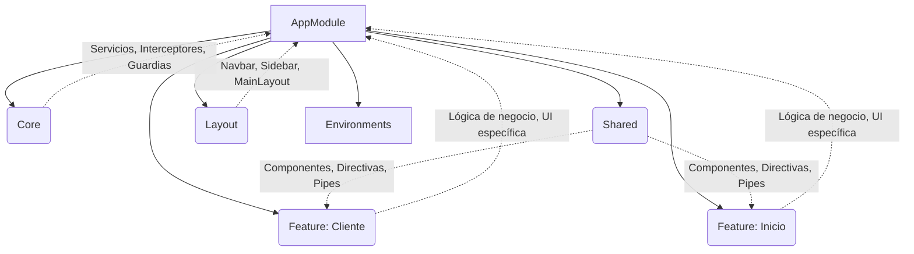

# Arquitectura del Proyecto Angular

## Descripción General

Este proyecto sigue una arquitectura modular basada en principios de Clean Architecture y las Style Guides oficiales de Angular. La estructura está diseñada para maximizar la escalabilidad, mantenibilidad y separación de responsabilidades, permitiendo un desarrollo eficiente y seguro en equipos grandes.

---

## Capas Principales y Responsabilidades

### 1. **Core**
- **Propósito:** Contiene servicios singleton, interceptores, guardias, utilidades globales y configuraciones que deben estar disponibles en toda la aplicación.
- **Qué debe ir aquí:**
  - Servicios de autenticación, logging, manejo de errores globales.
  - Interceptores HTTP.
  - Guardias de rutas globales.
  - Constantes y configuraciones globales.
- **Reglas:**
  - No debe depender de ninguna otra capa de la aplicación.
  - Solo se importa en el `AppModule`.

### 2. **Shared**
- **Propósito:** Componentes, directivas, pipes y utilidades reutilizables en múltiples módulos.
- **Qué debe ir aquí:**
  - Componentes de UI genéricos (botones, inputs, tablas, etc.).
  - Directivas y pipes reutilizables.
  - Constantes y helpers compartidos.
- **Reglas:**
  - No debe contener lógica de negocio específica.
  - Puede ser importado por cualquier feature module.

### 3. **Feature**
- **Propósito:** Implementa la lógica de negocio y la UI específica de cada dominio funcional.
- **Qué debe ir aquí:**
  - Componentes, servicios y módulos relacionados a una funcionalidad o dominio (ej: cliente, inicio, etc.).
  - Gestión de estado local o integración con NgRx/Signals.
- **Reglas:**
  - Puede importar de `shared` y `core`, pero nunca de otros features.
  - Debe ser lazy-loaded si es posible.

### 4. **Layout**
- **Propósito:** Define la estructura visual general de la aplicación (navegación, header, footer, etc.).
- **Qué debe ir aquí:**
  - Componentes de layout (navbar, sidebar, main-layout, etc.).
- **Reglas:**
  - Solo contiene componentes de estructura, sin lógica de negocio.

### 5. **Environments**
- **Propósito:** Configuración de variables de entorno para diferentes ambientes (dev, prod, etc.).
- **Qué debe ir aquí:**
  - Archivos de configuración de entorno.
- **Reglas:**
  - No debe contener lógica de negocio ni componentes.

### 6. **Feature-Routes**
- **Propósito:** Centraliza y desacopla la definición de rutas de cada feature, permitiendo que cada dominio funcional gestione su propio archivo de rutas de manera independiente.
- **Qué debe ir aquí:**
  - Archivos de rutas específicos de cada feature (por ejemplo, `cliente.routes.ts`, `inicio.routes.ts`).
  - Configuración de rutas para lazy loading y guards propios del feature.
- **Reglas:**
  - Solo debe importar de su propio feature, de `shared`, `core` o `env`.
  - No debe contener lógica de negocio ni componentes, solo definición de rutas y guards asociados.
- **¿Por qué se usa?**
  - Facilita el lazy loading y la modularidad, permitiendo que cada feature evolucione de forma independiente.
  - Mejora la mantenibilidad y escalabilidad, ya que las rutas no se mezclan en un único archivo global.
  - Permite aplicar guards y resolvers específicos a nivel de feature, siguiendo el principio de separación de responsabilidades.

---

## Reglas de Arquitectura
- **Separación estricta de responsabilidades:** Cada capa tiene un propósito claro y no debe mezclar responsabilidades.
- **Importación controlada:**
  - `core` y `shared` pueden ser importados por cualquier feature.
  - Los features no deben importarse entre sí.
- **Lazy Loading:** Los módulos de feature deben ser lazy-loaded para optimizar el rendimiento.
- **Tipado fuerte:** Uso estricto de TypeScript y tipado en todas las interfaces y servicios.
- **Reutilización:** Componentes y utilidades reutilizables deben estar en `shared`.
- **Singletons:** Solo en `core`.

---

## Diagrama de Arquitectura



---

## Ejemplo de Estructura de Carpetas

```
src/
  app/
    core/
    shared/
    feature/
      cliente/
      inicio/
    layout/
  environments/
```

---

## Buenas Prácticas
- Seguir las Style Guides oficiales de Angular.
- Usar OnPush Change Detection y Signals para optimización.
- Mantener la lógica de negocio fuera de los componentes de presentación.
- Escribir pruebas unitarias y de integración para cada feature.
- Documentar los servicios y componentes públicos.

---

Para dudas o sugerencias sobre la arquitectura, consulta con el equipo de arquitectura o revisa la documentación oficial de Angular.
